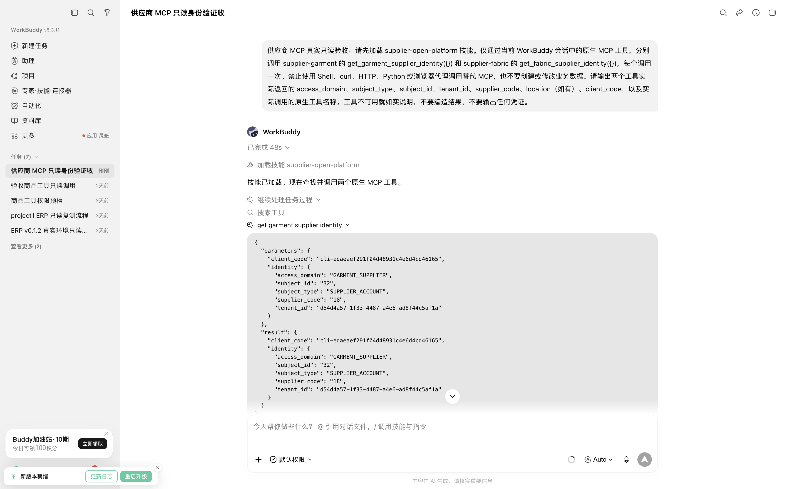
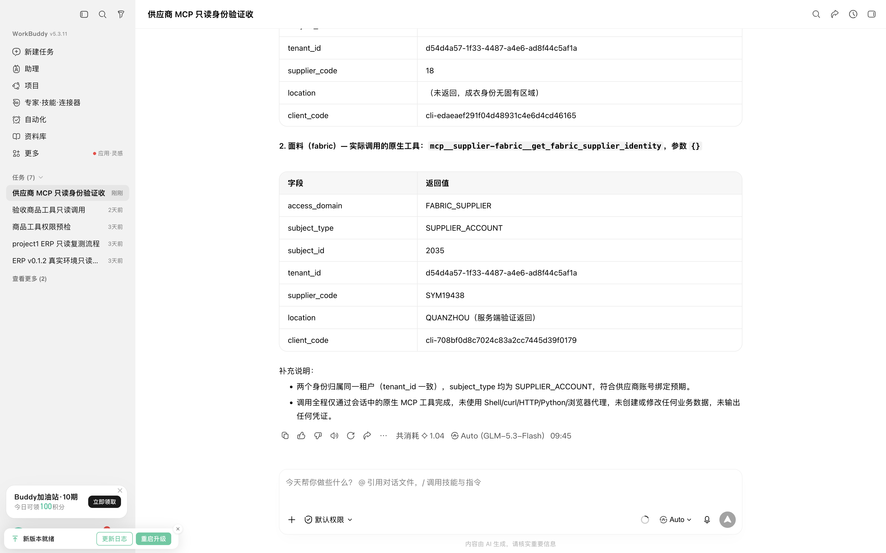
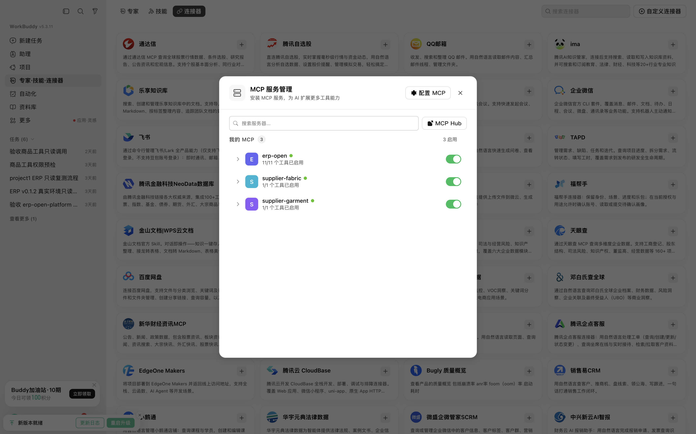

# WorkBuddy 原生供应商 MCP 验收

日期：2026-11-09（UTC+08）；工单：GYXT-35342。**限定验收场景 5/5 PASS。**

## 环境与方法

使用从 GitHub Release 下载并校验的 **v0.1.0 macOS arm64 包**、真实 WorkBuddy **5.3.11** 和 project1 本机开放平台。面料与成衣分别签发短期身份只读 Key，通过 `--key-stdin` 安装；没有使用模拟业务响应。安装器的两次身份预检与桌面原生调用分开统计。

重启 WorkBuddy 后，在“专家·技能·连接器 → 连接器 → 自定义连接器”分别完成两台供应商服务器的首次信任。原生界面显示 `supplier-fabric`、`supplier-garment` 各 1/1 个工具，原 ERP 连接保持 11/11。会话实际加载 `supplier-open-platform`，原生工具各调用一次，输入为 `{}`；未通过 Shell、curl 或自建 HTTP 客户端替代验收。

## 冻结场景

| 场景 | 结果 | 证据 |
| --- | --- | --- |
| WB-MCP-001：Skill 实际加载 | PASS | 原生轨迹出现“加载技能 supplier-open-platform” |
| WB-MCP-002：原生工具发现、ERP 并存 | PASS | 三个连接工具数 11/11、1/1、1/1 |
| WB-MCP-003：成衣绑定及原生调用 | PASS | 账号 32，公司 18，服务端 MCP SUCCESS |
| WB-MCP-004：面料绑定及原生调用 | PASS | 账号 2035，公司 SYM19438，区域 QUANZHOU，服务端 MCP SUCCESS |
| WB-MCP-005：两个域分别发现与返回对应身份 | PASS | 无身份串用；两个工具分别返回 SUPPLIER_ACCOUNT、预期租户及各自 Client |

## 服务端交叉验证

| 原生工具 | 调用时间（UTC+08） | 审计事件 ID | 结果 |
| --- | --- | --- | --- |
| `get_garment_supplier_identity` | 09:44:41.146 | `3c327c11-d5cd-42f8-b85f-68aa89244853` | MCP SUCCESS |
| `get_fabric_supplier_identity` | 09:44:41.040 | `8ce35c3c-a8f1-4de4-87ac-eaca06b23970` | MCP SUCCESS |

租户、Client、主账号及公司均与服务端绑定核对。成衣结果未返回固有区域；面料返回目录确认的 QUANZHOU。

## 清理与验收边界

两个临时 Key 已吊销并归档，再次请求分别为 HTTP 401；原有成衣测试 Key 保持 ACTIVE。临时 MCP 连接、Skill、信任条目与测试私密文件已移除，原 WorkBuddy ERP 配置还原，桌面恢复普通启动，调试端口关闭。平台按设计保留归档元数据、安全审计和原生验收会话。

以上 100% 仅针对这五项冻结场景，不表示所有供应商业务通过。当前只开放身份查询；订单、报价、发货尚未开放。未验收生产部署、其他账号、跨租户负面攻击或账号状态变更的原生场景。

**版本归属：** 原生验收针对 v0.1.0。v0.1.1 把这份记录和截图纳入离线文档，更新版本元数据及接入说明，未改变调用逻辑；v0.1.1 自动化及安装包校验单独执行。

平台完整本机运行记录位于 `output/test-reports/supplier-workbuddy-mcp-20261109/`，包括冻结矩阵、执行账本、审计和清理记录；不随包分发临时凭证或原始私密配置。
